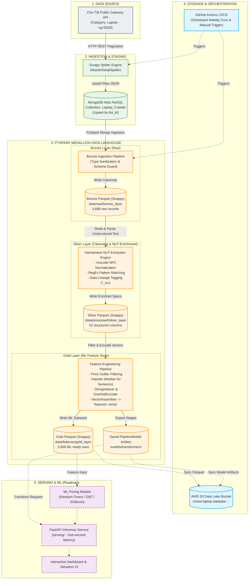
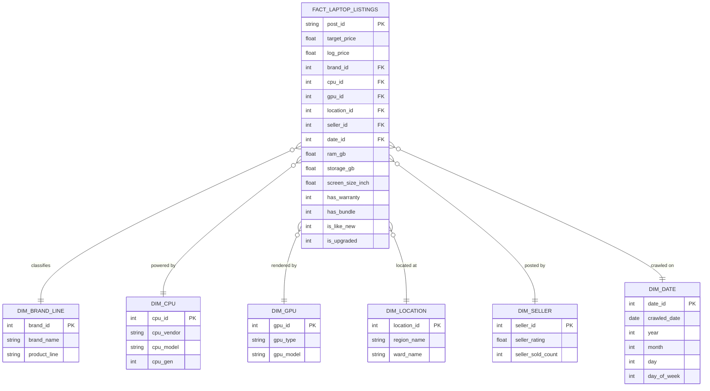

# 💻 Research and development of a pricing system for used laptops based on NLP and ML

[](https://www.python.org/)
[](https://spark.apache.org/)
[](https://scrapy.org/)
[](https://www.mongodb.com/)
[](https://aws.amazon.com/s3/)
[](https://docs.pytest.org/)
[-blue?style=for-the-badge)](#-architecture--data-flow)

> **Dự án Đồ án 2 (MI3390) - Đại học Bách Khoa Hà Nội (HUST)**  
> **Trọng tâm hiện tại**: Xây dựng hoàn chỉnh hạ tầng Data Pipeline tự động hóa (Data Ingestion $\rightarrow$ Medallion Lakehouse $\rightarrow$ NLP Information Extraction $\rightarrow$ ML Feature Engineering Pipeline).

---

## 📌 Mục Lục
1. [Business Value & Bài Toán Kinh Doanh](#1-tiêu-đề--tóm-tắt-giá-trị-title--business-value)
2. [Sơ Đồ Kiến Trúc Hệ Thống (Architecture & Data Flow)](#2-sơ-đồ-kiến-trúc-hệ-thống-architecture--data-flow)
3. [Công Nghệ Sử Dụng (Tech Stack)](#3-công-nghệ-sử-dụng-tech-stack)
4. [Nguồn Dữ Liệu & Mô Hình Dữ Liệu (Data Source & Data Model)](#4-nguồn-dữ-liệu--mô-hình-dữ-liệu-data-source--data-model)
5. [Hướng Dẫn Cài Đặt (Prerequisites & Setup)](#5-hướng-dẫn-cài-đặt-prerequisites--setup)
6. [Hướng Dẫn Chạy Pipeline (How to Run the Pipeline)](#6-hướng-dẫn-chạy-pipeline-how-to-run-the-pipeline)
7. [Kết Quả & Phân Tích Dữ Liệu (Results & Insights)](#7-kết-quả--phân-tích-dữ-liệu-results--insights)
8. [Tiến Độ Hiện Tại & Lộ Trình Phát Triển (Roadmap)](#8-tiến-độ-hiện-tại--lộ-trình-phát-triển-roadmap)

---

## 1. 🎯 Tiêu Đề & Tóm Tắt Giá Trị (Title & Business Value)

### 1.1. Bối cảnh & Bài toán kinh doanh (The Business Problem)
Thị trường thiết bị điện tử đã qua sử dụng, đặc biệt là **laptop cũ**, tại Việt Nam là một thị trường giao dịch khổng lồ nhưng tồn tại rào cản nghiêm trọng: **Bất cân xứng thông tin (Information Asymmetry)** và **dữ liệu phi cấu trúc (Unstructured Text)**:
- **Người mua cá nhân**: Khó xác định mức giá công bằng (Fair Market Value). Dễ rơi vào bẫy giá ảo, mua hớ linh kiện đời cũ hoặc mua nhầm máy lỗi/hàng dựng.
- **Người bán cá nhân**: Thiếu công cụ tham chiếu thời gian thực để định giá cạnh tranh dẫn đến tình trạng treo tin quá lâu hoặc bị ép giá dưới giá trị thực.
- **Đơn vị thu mua & Cửa hàng kinh doanh**: Cần tự động hóa việc sàng lọc hàng ngàn tin đăng mỗi ngày trên các sàn C2C để phát hiện ngay các cơ hội mua gom giá hời (**Arbitrage / Undervalued Listings**) trước đối thủ.

### 1.2. Thách thức kỹ thuật dữ liệu (The Data Challenge)
Các tin đăng trên các nền tảng thương mại điện tử C2C (như Chợ Tốt) chứa dữ liệu phi cấu trúc rất phức tạp:
1. **Dữ liệu phân tán & không chuẩn hóa**: Cấu hình phần cứng (CPU, GPU, RAM, Ổ cứng, Tình trạng bảo hành, Xuất xứ) bị ẩn trong tiêu đề hoặc mô tả văn bản tự do, viết tắt (VD: `i5 1135g7`, `r5 5600h`, `ram16 nvme 512`, `zin keng 99%`, `pin 3-4h`).
2. **Nhiễu & Giá ảo (Anomalies & Outliers)**: Xuất hiện nhiều tin đăng giá `0đ`, `1.000đ` (để thương lượng) hoặc giá ảo lên tới hàng trăm triệu đồng.
3. **Thiếu vắng Data Pipeline chuẩn hóa**: Không có cơ chế lưu trữ tập trung và truy vết nguồn gốc (Data Lineage) cho các đặc trưng phục vụ Machine Learning.

### 1.3. Giải pháp & Giá trị mang lại (Our Solution & Value Proposition)
Hệ thống giải quyết bài toán trên bằng cách xây dựng một **Data Platform End-to-End**:
- **Tự động hóa thu thập dữ liệu (Automated Ingestion)**: Scrapy Crawler tích hợp API gateway Chợ Tốt, thu nạp liên tục và lưu trữ vào MongoDB Atlas NoSQL.
- **Kiến trúc Hồ dữ liệu Medallion (Lakehouse Architecture)**: Chuẩn hóa 3 tầng dữ liệu **Bronze (Raw) $\rightarrow$ Silver (Cleaned & NLP Enriched) $\rightarrow$ Gold (ML Feature Store)** trên nền tảng **Apache Spark (PySpark)** kết hợp định dạng **Parquet Snappy**.
- **Engine trích xuất thông tin tiếng Việt (Vietnamese Domain-specific NLP Engine)**: Tự động bóc tách hơn **30+ thuộc tính kỹ thuật & thương mại** từ văn bản tự do với cơ chế ranh giới từ Unicode an toàn (`\p{L}\p{N}`).
- **Sẵn sàng cho mô hình hóa (ML-Ready Feature Engineering)**: Đóng gói toàn bộ biến đổi (Imputer, StringIndexer, OneHotEncoder, VectorAssembler) thành **PySpark PipelineModel Artifacts**, sẵn sàng cho các thuật toán định giá tự động.

---

## 2. 🏗 Sơ Đồ Kiến Trúc Hệ Thống (Architecture & Data Flow)

Hệ thống được thiết kế theo chuẩn **Medallion Architecture (Bronze - Silver - Gold)** kết hợp tự động hóa qua **GitHub Actions CI/CD** và lưu trữ đám mây **AWS S3**:



---

## 3. 🛠 Công Nghệ Sử Dụng (Tech Stack)

| Thành phần | Công nghệ | Lý do lựa chọn kỹ thuật |
| :--- | :--- | :--- |
| **Web Crawling** | **Scrapy 2.12+** | Framework bất đồng bộ (Twisted event loop), tốc độ cao, hỗ trợ phân trang thông minh (`offset`), kiểm soát rate-limit và xử lý Pipeline mượt mà. |
| **Raw Staging DB** | **MongoDB Atlas** | CSDL NoSQL Document-based linh hoạt, lưu trữ trực tiếp toàn bộ payload JSON động từ Chợ Tốt API với cơ chế `upsert` theo `list_id` tránh trùng lặp. |
| **Big Data Engine** | **Apache Spark (PySpark 4.2+)** | Động cơ tính toán phân tán trong bộ nhớ (In-memory computing). Xử lý dữ liệu lớn, tính toán song song, tích hợp sẵn module PySpark MLlib và native Parquet IO. |
| **Data Lake Format** | **Apache Parquet (Snappy)** | Định dạng lưu trữ dạng cột (Columnar format) chuẩn doanh nghiệp, tỷ lệ nén cao, tiết kiệm dung lượng đĩa, tối ưu đọc theo cột (predicate pushdown). |
| **NLP & Text Mining** | **Python Regex + Unicode NFC** | Chuẩn hóa bảng mã tiếng Việt, xử lý ranh giới từ `(?<![\p{L}\p{N}])` và `(?![\p{L}\p{N}])` để bóc tách chính xác model CPU/GPU mà không bắt nhầm phụ âm. |
| **Feature Engineering** | **PySpark ML Pipeline** | Chuẩn hóa quy trình tiền xử lý đặc trưng (Imputer $\rightarrow$ StringIndexer $\rightarrow$ OneHotEncoder $\rightarrow$ VectorAssembler) thành 1 artifact thống nhất, chống Data Leakage. |
| **Cloud Storage** | **AWS S3** | Kho lưu trữ đối tượng bền vững (99.999999999% durability), chi phí rẻ, đồng bộ hóa tự động dữ liệu Parquet và Model artifacts từ local lên cloud. |
| **Orchestration & CI/CD** | **GitHub Actions** | Tự động hóa lịch chạy định kỳ (Weekly Cron: 00:00 Thứ 2 hàng tuần) từ Scrapy $\rightarrow$ PySpark ETL $\rightarrow$ Sync AWS S3 mà không cần duy trì server riêng. |
| **Testing & Quality** | **PyTest + Unit Mocks** | Bộ 45 kịch bản kiểm thử tự động, mock JVM SparkContext để chạy nhanh trong môi trường CI/CD, đảm bảo độ tin cậy tuyệt đối cho code pipeline. |

---

## 4. 📊 Nguồn Dữ Liệu & Mô Hình Dữ Liệu (Data Source & Data Model)

### 4.1. Nguồn dữ liệu (Data Source)
- **Nguồn**: Gateway API công khai của Chợ Tốt (`https://gateway.chotot.com/v1/public/ad-listing?limit=50&cg=5030&st=s,k&key_param_included=true`).
- **Phân loại**: Chuyên mục Điện tử / Laptop (`cg=5030`).
- **Quy mô hiện tại**: **3,698 tin đăng thực tế** đã được thu thập và xử lý qua toàn bộ pipeline ETL.

### 4.2. Kiến trúc dữ liệu phân tầng (Medallion Data Architecture)

```
data/
├── raw/
│   └── bronze_layer/           <- Dữ liệu thô từ MongoDB, giữ nguyên kiểu và định dạng NoSQL
├── processed/
│   └── silver_layer/           <- 52 thuộc tính chuẩn hóa, bóc tách cấu hình NLP và gắn Data Lineage
└── features/
    └── gold_layer/             <- Feature Store dạng vector ML, đã lọc nhiễu giá và log-transform
```

#### Tầng 1: Bronze Layer (Raw Parquet)
- Lưu trữ toàn bộ dữ liệu thô từ MongoDB kèm Metadata hệ thống: `_ingested_at`, `_ingested_date`, `_source`.
- Áp dụng cơ chế **Type Sanitization**: chuẩn hóa kiểu dữ liệu giữa các documents NoSQL không đồng nhất (ép kiểu float/int xung đột, chuyển `_id` thành chuỗi) nhằm triệt tiêu lỗi `CANNOT_MERGE_TYPE` của Spark.

#### Tầng 2: Silver Layer (Cleaned & NLP-Enriched Parquet - 52 Cột)
Áp dụng **Domain-Specific NLP Engine** trích xuất thông tin kỹ thuật từ cả `title` và `description`:
- **Thông số cốt lõi**: `brand_name`, `product_line` (MacBook Pro/Air, ThinkPad, Dell XPS, Legion, ROG...), `cpu_vendor` (Intel, AMD, Apple), `cpu_model`, `cpu_gen`, `gpu_type` (Integrated vs Discrete), `gpu_model` (RTX 3060, GTX 1650, Iris Xe...), `screen_size_inch`, `resolution` (FHD, 2K, Retina, 4K...), `touch_sensitive`.
- **Tình trạng máy & Pin**: `is_new_seal`, `is_like_new`, `condition_pct` (80-99%), `battery_hours`, `battery_pct`, `battery_condition`, `is_upgraded`, `repair_status` (Zin nguyên bản vs Đã sửa chữa).
- **Thương mại & Địa lý**: `warranty_months`, `has_warranty`, `has_bundle` (quà tặng kèm), `seller_rating`, `seller_sold_count`, `region_name`, `ward_name`.
- **Data Lineage**: Mọi trường trích xuất đều đi kèm cột `*_src` (ghi nhận thuộc tính được bóc tách từ `title` hay `description` để phục vụ audit dữ liệu).

#### Tầng 3: Gold Layer (ML Feature Store Parquet)
- **Data Cleansing Gate**: Lọc bỏ giá ảo không hợp lệ (giữ các tin có $500.000 \le \text{price} \le 200.000.000$ VNĐ).
- **Missing Value Handling**:
  - Imputer (Chiến lược **Median**) cho các biến số: `ram_gb`, `storage_gb`, `cpu_gen`, `screen_size_inch`, `seller_sold_count`, `year_production`.
  - Gán nhãn `"unknown"` cho các biến phân loại thiếu dữ liệu.
- **Categorical Encoding**: `StringIndexer` + `OneHotEncoder` với cờ `handleInvalid="keep"`.
- **Vector Assembly**: Đóng gói toàn bộ biến nhị phân, biến số chuẩn hóa và vector OHE vào cột `features`.
- **Target Variable**: Cung cấp song song `target_price` và `log_price` ($\ln(1 + \text{price})$) để triệt tiêu độ lệch phải (skewness) của biến giá.

### 4.3. Mô hình dữ liệu quan hệ (Star Schema Data Warehouse)
Nếu chuyển đổi dữ liệu từ Data Lake sang Data Warehouse phân tích kinh doanh (OLAP / BI):



---

## 5. ⚙️ Hướng Dẫn Cài Đặt (Prerequisites & Setup)

### 5.1. Yêu cầu hệ thống (Prerequisites)
- **Hệ điều hành**: Windows 10/11, macOS, hoặc Ubuntu Linux.
- **Python**: Phiên bản `>= 3.10` (Khuyến nghị `3.12`).
- **Java**: **OpenJDK 17** (Bắt buộc cho PySpark).
- **Hadoop Binaries (Nếu chạy trên Windows)**: Cài đặt `winutils.exe` vào `C:\hadoop\bin` và đặt biến `HADOOP_HOME=C:\hadoop`.

### 5.2. Các bước cài đặt chi tiết

```bash
# 1. Clone repository về máy
git clone https://github.com/your-username/laptop-pricing-system.git
cd laptop-pricing-system

# 2. Khởi tạo môi trường ảo Python
python -m venv .venv

# Kích hoạt môi trường ảo:
# Trên Windows (PowerShell):
.venv\Scripts\Activate.ps1
# Trên Linux/macOS:
source .venv/bin/activate

# 3. Cài đặt toàn bộ dependencies
pip install --upgrade pip
pip install -r crawler/requirements-crawler.txt
pip install pyspark==4.2.1 python-dotenv numpy pandas pyarrow pytest
```

### 5.3. Cấu hình biến môi trường (`.env`)
Tạo file `.env` ở thư mục gốc của project:
```ini
# MongoDB Atlas Staging Credentials
MONGO_URI="mongodb+srv://<username>:<password>@cluster0.xxxxx.mongodb.net"
MONGO_DB="scrapy_db"
MONGO_COLL_RAW="Laptop_Crawler"

# Data Lake Local Paths
DATALAKE_BRONZE_DIR="./data/raw/bronze_layer"
DATALAKE_SILVER_DIR="./data/processed/silver_layer"
DATALAKE_GOLD_DIR="./data/features/gold_layer"
MODEL_TRANSFORMER_DIR="./models/transformers"

# AWS S3 Data Lake (Optional for Local runs)
AWS_ACCESS_KEY_ID="your_aws_access_key"
AWS_SECRET_ACCESS_KEY="your_aws_secret_key"
AWS_REGION="ap-southeast-2"
AWS_S3_BUCKET="your-s3-bucket-name"
```

---

## 6. 🚀 Hướng Dẫn Chạy Luồng Dữ Liệu (How to Run the Pipeline)

Pipeline được thiết kế theo module hóa cao độ, có thể thực thi từng bước độc lập hoặc chạy trọn gói qua Master Orchestrator.

### Bước 1: Thu thập dữ liệu từ Chợ Tốt (Web Crawling)
Khởi chạy Scrapy Spider để quét các tin đăng mới nhất và lưu trữ vào MongoDB Atlas:
```bash
cd crawler
scrapy crawl chotot_laptop -s CLOSESPIDER_ITEMCOUNT=2000
cd ..
```

### Bước 2: Chạy trọn vẹn quy trình Medallion ETL (Bronze $\rightarrow$ Silver $\rightarrow$ Gold)
Lệnh điều phối duy nhất kích hoạt Spark ETL Pipeline với cơ chế chia sẻ `SparkSession` tối ưu:
```bash
python -m src.data_pipeline.main_etl
```

*Hoặc có thể chạy riêng từng tầng để kiểm thử dữ liệu:*
```bash
# Chỉ chạy Ingestion sang Bronze:
python -m src.data_pipeline.bronze_layer

# Chỉ chạy Clean & NLP sang Silver:
python -m src.data_pipeline.silver_layer

# Chỉ chạy Feature Engineering sang Gold:
python -m src.data_pipeline.gold_layer
```

### Bước 3: Chạy bộ kiểm thử tự động (Unit Tests)
Dự án được bảo vệ bởi **45 unit tests** kiểm tra tính đúng đắn từ Crawler, Regex patterns, Spark ETL đến Data Quality Gates:
```bash
pytest tests/
```
```text
======================== 45 passed in 8.52s ========================
```

### Bước 4: Khám phá phân tích dữ liệu (EDA Notebook)
Khởi chạy Jupyter Notebook để xem các biểu đồ phân tích trực quan về mức giá, thương hiệu và cấu hình:
```bash
jupyter notebook notebooks/02_eda_and_modeling.ipynb
```

---

## 7. 📈 Kết Quả & Phân Tích Dữ Liệu (Results & Insights)

### 7.1. Hiệu năng thực thi Pipeline (Pipeline Execution Metrics)
Kết quả ghi nhận từ hệ thống nhật ký giám sát tập trung (`logs/etl_pipeline/main_etl.log`):

| Tầng ETL | Đầu vào (Input) | Đầu ra (Output) | Thời gian xử lý | Tác vụ trọng tâm |
| :--- | :--- | :--- | :--- | :--- |
| **Bronze Layer** | MongoDB Atlas Collections | **3,698 records** | **~24.2 giây** | Đồng nhất kiểu NoSQL, thêm metadata, ghi Parquet Snappy |
| **Silver Layer** | 3,698 Bronze records | **3,698 records** | **~22.9 giây** | Chuẩn hóa NFC tiếng Việt, Regex NLP bóc tách 30+ trường cấu hình |
| **Gold Layer** | 3,698 Silver records | **3,669 feature vectors** | **~8.7 giây** | Lọc 29 tin giá ảo, Imputation, One-Hot Encoding, sinh Vector ML |
| **Toàn bộ Pipeline** | MongoDB NoSQL | **Gold Parquet + ML Artifacts** | **~81 - 85 giây** | **Hoàn thành End-to-End với 100% dữ liệu toàn vẹn** |

### 7.2. Tương quan thực tế giữa Cấu hình và Giá bán (EDA Findings)
Từ dữ liệu đã làm sạch ở tầng Silver, phân tích hệ số tương quan thứ hạng (**Spearman Correlation**) với biến giá mục tiêu (`target_price`) cho kết quả thực nghiệm rõ ràng:

```
=== HỆ SỐ TƯƠNG QUAN VỚI GIÁ BÁN LAPTOP CŨ ===
1. Dung lượng RAM (raw_ram)         : +0.739  ████████████████ (Tác động mạnh nhất đến giá)
2. Dung lượng Ổ cứng (raw_storage)  : +0.687  ██████████████   (SSD dung lượng lớn giữ giá tốt)
3. Thế hệ CPU (cpu_gen)             : +0.612  ████████████     (Chip đời cao có giá vượt trội)
4. Thời hạn bảo hành (warranty)    : +0.382  ████████         (Còn bảo hành chính hãng là điểm cộng lớn)
5. Độ mới ngoại hình (condition_pct): +0.311  ██████           (Máy like-new/keng giữ giá hơn)
6. Kích thước màn hình (screen_size): +0.283  █████            (Dòng 15.6 - 16 inch giá nhỉnh hơn 13-14 inch)
7. Uy tín người bán (seller_sold)   : +0.166  ███              (Cửa hàng bán nhiều tin thường niêm yết giá cao hơn)
8. Màn hình cảm ứng (touch_screen)  : +0.043  █                (Tác động không đáng kể đến giá định giá)
9. Điểm đánh giá (seller_rating)    : +0.002  |                (Gần như không tương quan trực tiếp đến giá bán)
```

> **Insight kinh doanh quan trọng**: 
> - Ba thông số kỹ thuật **RAM, Ổ cứng và Thế hệ CPU** chiếm hơn **70% trọng số quyết định giá** của một chiếc laptop đã qua sử dụng. 
> - Điểm đánh giá của người bán (`seller_rating`) không phản ánh giá trị máy, giúp loại bỏ việc gán nhầm trọng số cho biến này trong mô hình định giá.

---

## 8. 🗺️ Tiến Độ Hiện Tại & Lộ Trình Phát Triển (Roadmap)

### ✅ Giai đoạn 1: Data Engineering & Feature Infrastructure (ĐÃ HOÀN THÀNH 100%)
- [x] Xây dựng Scrapy Spider thu thập tự động dữ liệu Chợ Tốt API kèm phân trang.
- [x] Lưu trữ Staging an toàn trên MongoDB Atlas với cơ chế chống trùng lặp `upsert`.
- [x] Xây dựng kiến trúc Medallion Lakehouse 3 tầng (Bronze $\rightarrow$ Silver $\rightarrow$ Gold) bằng PySpark.
- [x] Phát triển Regex/NLP Engine xử lý ngôn ngữ tự nhiên tiếng Việt cho 30+ linh kiện phần cứng.
- [x] Thiết kế PySpark ML Feature Engineering Pipeline (Imputer, Indexer, Encoder, VectorAssembler).
- [x] Viết trọn bộ 45 Unit Tests kiểm thử tự động toàn diện.
- [x] Thiết lập CI/CD Workflow định kỳ hàng tuần qua GitHub Actions và đồng bộ hóa lên AWS S3.

### 🔄 Giai đoạn 2: Model Training & Evaluation (Đang tiến hành)
- [ ] Huấn luyện và so chuẩn (Benchmark) các mô hình hồi quy:
  - Baseline: Linear Regression / Ridge Regression.
  - Tree-based: Random Forest Regressor, Gradient-Boosted Trees (PySpark GBTRegressor).
  - State-of-the-art: LightGBM / XGBoost Regressor.
- [ ] Tinh chỉnh siêu tham số (Hyperparameter Tuning qua Cross-Validation).
- [ ] Đánh giá độ chính xác qua các chỉ số: $R^2$, RMSE, MAE, MAPE.

### 🚀 Giai đoạn 3: Serving & Productization (Kế hoạch tiếp theo)
- [ ] Xây dựng RESTful API định giá thời gian thực bằng **FastAPI** (`serving/`).
- [ ] Phát triển Web Dashboard giao diện người dùng: Cho phép người dùng dán tiêu đề/mô tả tin đăng laptop để hệ thống tự động bóc tách cấu hình và trả về:
  - Giá định giá hợp lý (Fair Price Range).
  - Phân tích độ hời của tin đăng (Good Deal / Overpriced / Fair Deal).
- [ ] Đóng gói toàn bộ hệ thống bằng **Docker & Docker Compose**.

---

## 👨‍💻 Tác Giả & Liên Hệ
- **Họ và tên**: Trịnh Đình Phong
- **Đồ án**: Đồ án 2 (MI3390) - Khoa Toán - Tin, Đại học Bách Khoa Hà Nội (HUST).
- **Email**: phong.td.hust@gmail.com / phong.td23xxxx@sis.hust.edu.vn
- **GitHub**: [github.com/trinhdinhphong](https://github.com/)

